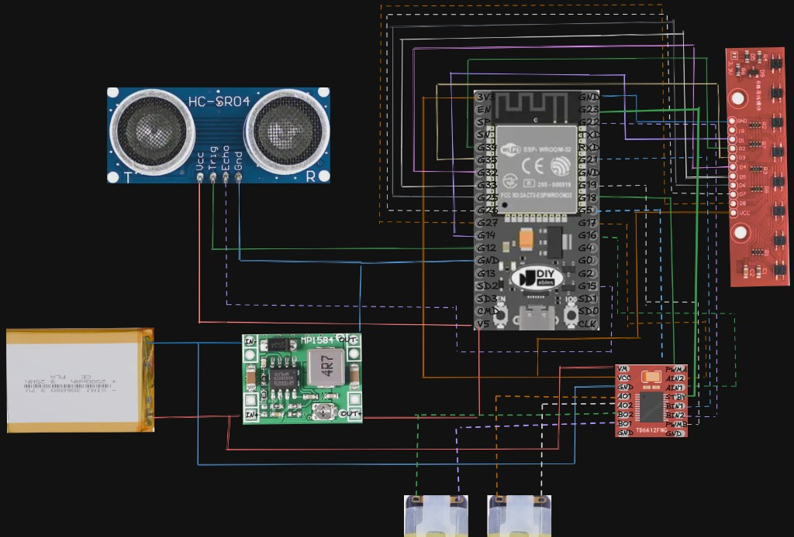

# Programa principal

`code.py` es el control ON/OFF del seguidor de línea. Una ESP32 lee ocho ADC de la QTR-8A, aplica reglas de movimiento a dos motores DC por el TB6612FNG y usa un HC-SR04 para arrancar y frenar. El montaje es modalidad B: baquela, palo de balso y protoboard pequeña sobre un chasis provisional.

## Cómo correrlo

1. Abrir `code.py` en Thonny, con el intérprete de MicroPython en la ESP32.
2. Guardarlo en la placa como `main.py`, o ejecutarlo con Run.
3. Alimentar con la batería (motores por el puente) y el regulador hacia la ESP32.
4. Acercar un obstáculo a ≤ 10 cm y retirarlo para iniciar. A ≤ 15 cm el robot se detiene.

GND es común a la ESP32, la regleta, el puente, el regulador y el ultrasonido. STBY del TB6612FNG queda en alto.

## Conexiones

| Señal | GPIO | Función |
| --- | --- | --- |
| S1 … S8 (QTR-8A) | 14, 34, 35, 32, 33, 25, 26, 27 | ADC, atenuación 11 dB |
| Motor A · PWM / AIN1 / AIN2 | 18 / 17 / 16 | Izquierdo · 1 kHz |
| Motor B · PWM / BIN1 / BIN2 | 19 / 21 / 22 | Derecho · 1 kHz |
| STBY (TB6612FNG) | 23 | Habilita el puente |
| TRIG / ECHO (HC-SR04) | 12 / 15 | Inicio ≤ 10 cm · parada ≤ 15 cm |

Esquemático del montaje:



## Chasis (modalidad B)

- **Baquela** con pines macho-hembra soldados: los módulos se enchufan y se pueden sacar.
- **Palo de balso** unido con amarraderas a la baquela: sostiene los dos motores.
- **Protoboard pequeña** fijada con una amarradera: ahí va la regleta de infrarrojos.

## Sensores y umbral

```text
cuenta = ADC.read()
si cuenta > 3700 → negro (1)
si no            → blanco (0)
```

3700 es el umbral probado en la pista del salón. Sobre negro la cuenta sube; sobre blanco baja.

## Motores

```text
duty = |porcentaje| / 100 × 1023
```

Porcentaje positivo: avance. Negativo: retroceso. Cero: parada.

| Constante | Valor | Para qué |
| --- | --- | --- |
| `FACTOR_A` | 0,85 | Compensa la distancia del motor izquierdo al centro |
| `FACTOR_B` | 1,00 | Motor derecho |
| `VELOCIDAD_ESCALA` | 0,45 | Baja la marcha para las curvas del salón; se puede subir |
| `SUAVIZADO` | 0,95 | Acerca la velocidad actual al objetivo en cada vuelta |

## Control ON/OFF

La primera condición verdadera gana, de S1 a S8. Los porcentajes de la guía se ajustaron a la disposición y distancia entre motores en el montaje físico. Después se aplican la escala y los factores.

| Sensor negro | Motor izq. | Motor der. | Movimiento |
| --- | --- | --- | --- |
| S1 | 70 % | −40 % | Derecha fuerte |
| S2 | 60 % | 10 % | Derecha marcada |
| S3 | 45 % | 30 % | Derecha suave |
| S4 o S5 | 40 % | 40 % | Recto |
| S6 | 30 % | 45 % | Izquierda suave |
| S7 | 10 % | 60 % | Izquierda marcada |
| S8 | −40 % | 70 % | Izquierda fuerte |
| Ninguno | 0 % | 0 % | Parada |

## HC-SR04

| Constante | Valor | Función |
| --- | --- | --- |
| `DIST_INICIO_CM` | 10 | Acercarse a ≤ 10 cm y retirar para arrancar |
| `DIST_PARADA_CM` | 15 | Obstáculo a ≤ 15 cm detiene el robot |

## Alimentación

La batería alimenta los motores por el TB6612FNG. Un regulador (MP1584) lleva la tensión segura a VIN / 5 V de la ESP32. El puente no entrega 5 V regulados: no se usa como fuente de la placa.

## Qué imprime

Al arrancar:

```text
Robot optimizado para pista pequeña listo...
```

Al iniciar o detener con el ultrasonido:

```text
¡Iniciado!
¡Detenido por obstáculo!
```
